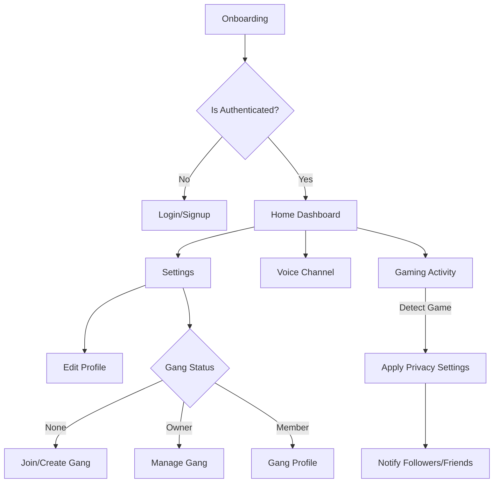

# Application Flow & Use Cases - Cum App

This document outlines the end-to-end user experience, UI transitions, and logic for the **Cum** mobile application.

## 1. High-Level Architecture Flow

---

## 2. Detailed Use Cases & UI Flows

### 2.1 Onboarding & Authentication
**Goal**: Get the user into the app with minimal friction.
- **UI State**: `OnboardingPage` -> `LoginPage`.
- **Flow**:
    1. User opens app -> 3D claymorphism slides explaining "Status Sync" and "Voice Channels".
    2. User reaches `LoginPage`.
    3. Options: Google, Facebook, Apple, or Email (Indigo theme).
    4. **Success**: Navigate to `HomePage`.

### 2.2 Profile Initialization
**Goal**: Define the user's gaming identity.
- **UI State**: `EditProfilePage`.
- **Flow**:
    1. User enters GamerTag (Max 15 chars).
    2. Selects/Uploads Avatar.
    3. Adds short Bio.
    4. **Logic**: Character limits enforced by `input.dart` components.

### 2.3 The "Gang" Experience
**Goal**: Community building and hierarchy.

#### A. Joining a Gang
1. User goes to **Settings** -> Taps **"Join a Gang"**.
2. Opens `JoinGangPage`.
3. User searches for Gang Name.
4. Taps **Join** -> Creates `player` doc (Role: Member).
5. UI updates: Settings now shows the Gang Name instead of "Join a Gang".

#### B. Creating a Gang
1. User goes to `JoinGangPage` -> Taps **"Create Gang"** button at bottom.
2. Opens `CreateGangPage`.
3. Enters Gang Name & Description.
4. **Logic**: User becomes Owner; default roles created.

#### C. Managing a Gang (Owner Only)
1. User goes to **Settings** -> Taps **[Gang Name]**.
2. Opens `EditGangPage`.
3. **Actions**:
    - **Edit Players**: View list, remove members.
    - **Edit Roles**: Define permissions for 'Member' vs 'Moderator'.
    - **Edit Profile**: Owner's specific alias within the gang.

### 2.4 Smart Activity Notifications (Core Feature)
**Goal**: Automate social connectivity.
- **Trigger**: System detects a game package launch (e.g., `com.mojang.minecraftpe`).
- **Flow**:
    1. App checks `GameLaunchSync` settings.
    2. **Logic**: If setting is "Friends Only", filter active friends list.
    3. Push Notification sent: *"🔥 [GamerTag] just jumped into [Game]! Tap to join voice."*
    4. **Privacy**: If "Incognito" is on, no notifications are sent.

### 2.5 Integrated Voice Communication
**Goal**: Low-latency coordination.
- **UI State**: `VoiceChannel` overlay or full-screen.
- **Flow**:
    1. User taps "Connect" on Home or via Notification.
    2. Joins active channel.
    3. **UI**: Shows active speaker avatars with "glow" effect (Primary Indigo).
    4. **Background**: Continues running even if user switches to the game.

---

## 3. UI/UX Possibilities & Interactivity

### 3.1 Micro-Animations
- **Button Press**: Slight scale down (0.95) and haptic feedback.
- **Status Sync**: A pulsing ring around the user's avatar when a game is active.
- **Gang Transition**: Smooth hero animation when moving from Settings to Gang management.

### 3.2 Performance & Efficiency
- **Idle Mode**: App enters low-power state when no game is detected.
- **Overlay**: Minimalist "Bubble" UI for voice controls while in-game.

---

## 4. Edge Cases & Error Handling

| Scenario | UX Response |
| :--- | :--- |
| **No Internet** | Show "Offline Mode" banner; cache pending profile edits. |
| **Gang Full** | Join button disabled with "Gang at capacity" message. |
| **Game Not Recognized** | Option to "Manually set status" for niche titles. |
| **Permission Denied** | Clear instructions on how to enable "Usage Access" for game detection. |
